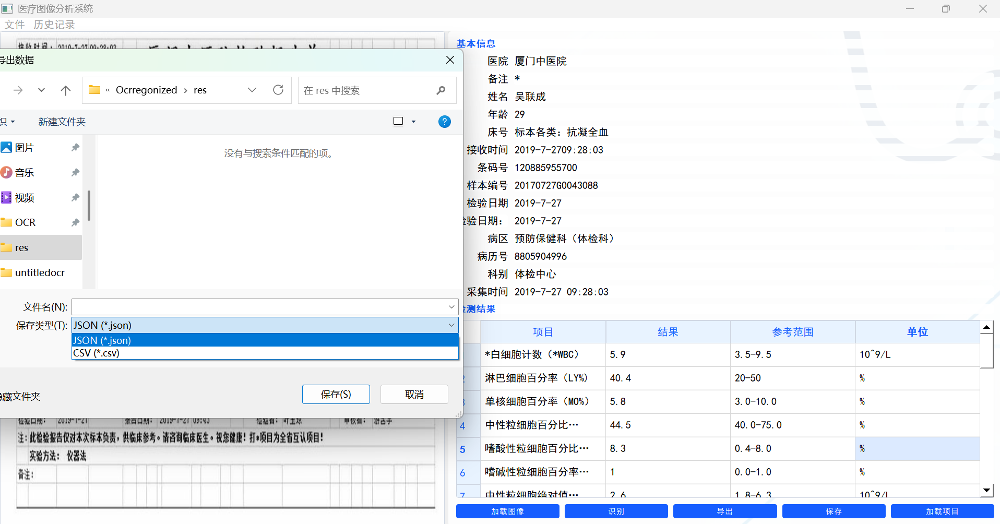
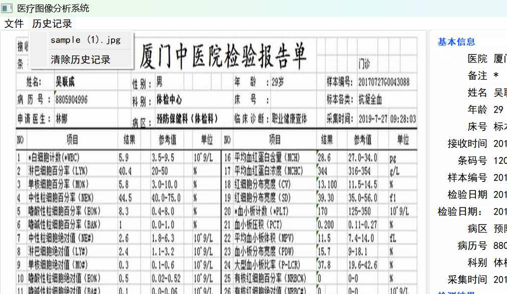
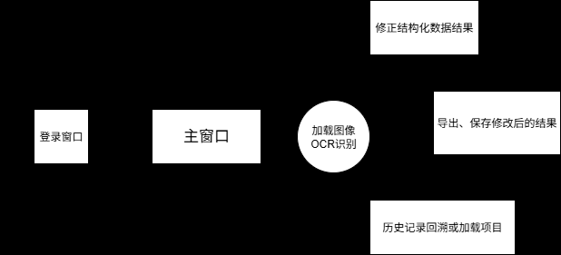
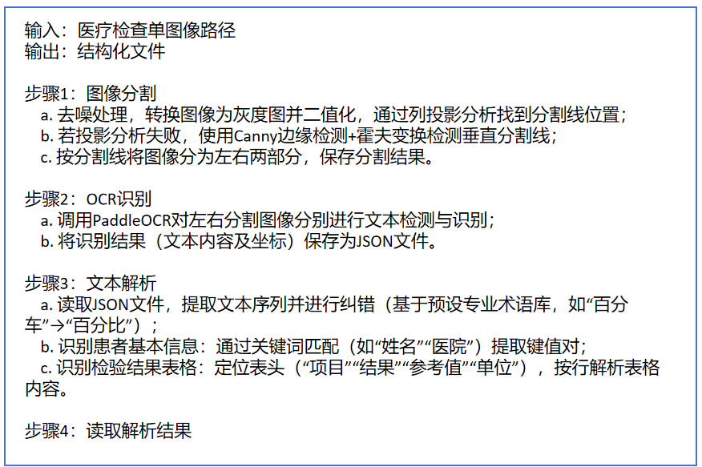

# 面向医院检查单的 OCR 结构化识别原型系统

> 「语言课程设计」课程作业 · 项目 5

一个把**医院检验报告单照片**变成**可编辑结构化数据**的原型系统：Qt 5.12（C++）桌面端负责交互与展示，PaddleOCR 3.x（PP-OCRv5，Python）负责识别，中间用「左右分栏切图 + 关键词定位 + 表头解析 + 医疗术语纠错」把一大串文字还原成患者信息和检验项目表格。



## 功能

| 功能 | 说明 |
| --- | --- |
| 登录保护 | 进入系统前需登录（演示账号 `admin` / `88888888`），用于提示「病人隐私数据」场景 |
| 加载图像 | 支持 JPG / PNG / JPEG / BMP / TIFF / WebP，左侧自适应显示 |
| OCR 识别 | 自动检测分栏位置切开左右两半，分别送 PaddleOCR 识别，输出文本与坐标 JSON |
| 结构化提取 | 基本信息用关键词定位（姓名、性别、年龄、医院、条码号…），检验结果用连续表头 `项目/结果/参考值/单位` 定位后按行解析 |
| 术语纠错 | 内置医疗术语纠错字典，修正形近字与单位误识别（如 `百分车 → 百分比`、`£/tL → fL`） |
| 结果编辑 | 基本信息用可编辑表单，检验结果用可编辑表格，改动实时回写到数据模型 |
| 导出 | 导出为 JSON 或 CSV（两段式：基本信息 + 检验结果） |
| 项目保存 / 加载 | 保存 JSON 时一并记录图像路径，重新加载可还原图片与全部数据 |
| 历史记录 | 菜单中回溯本次会话识别过的记录，可一键清除 |

识别效果（左图原图，右侧结构化结果）：



## 系统流程



## 技术栈

- **桌面端**：C++14 / Qt 5.12.10 / MinGW 7.3 64-bit，qmake 工程，纯代码构建 UI（`.ui` 仅保留空壳）
- **识别后端**：Python 3.12 / PaddleOCR 3.2.0 / PaddlePaddle 3.0.0 / OpenCV 4.10，模型为 PP-OCRv5 mobile（det + rec）
- **数据交换**：Qt 通过 `QProcess` 调 Python 脚本，脚本把结果写成 CSV 并在 stdout 打印 `CSV_PATH:...`，Qt 端解析该路径与 CSV

## 处理流程



1. **图像分割**：灰度化 + 二值化后做列投影，在图像中部找投影最小值作为切分线；失败则退化为 Canny 边缘检测 + 霍夫变换找垂直直线，再不行就取中线。切分线右移 50px 以保住表格完整。
2. **OCR 识别**：左右两半分别调用 `ocr.predict()`，每条结果保存为 PaddleOCR 的 JSON（含 `rec_texts` 与坐标）。
3. **文本解析**：读取 `rec_texts`，先套用纠错字典；再用 `关键词：值` 模式抽取基本信息；最后寻找连续表头（项目 / 结果 / 参考值 / 单位），四列一组顺序读取，遇到「日期 / 注 / 方法 / 检验者 / 审核者」等非表格行跳过。
4. **结果落地**：合并左右两半的结果，写 CSV（`### Patient Basic Information` + `### Test Results Table` 两段），Qt 端解析后填入表单和表格。

整体复杂度约 `O(W×H + N + M)`（W、H 为图像宽高，N 为文本区域数，M 为抽取文本数）；自测单张约 5 秒，准确率 90% 以上（对规定的双栏血常规模板）。

## 目录结构

```
hospital-ocr-report/
├── qt-app/                     # Qt 桌面端（qmake 工程）
│   ├── untitledocr.pro
│   ├── main.cpp                # 登录 → 主窗口
│   ├── loginwindow.{h,cpp,ui}  # 登录窗口
│   ├── mainwindow.{h,cpp,ui}   # 主窗口：加载/识别/编辑/导出/历史
│   ├── document.{h,cpp}        # 数据模型 + JSON 读写
│   ├── imagehandler.{h,cpp}    # 图像路径与 QPixmap
│   ├── pythoncaller.{h,cpp}    # QProcess 调用 Python
│   ├── res1.qrc                # 资源：1.png / 2.png / 3.png / sample (1).jpg
│   └── *.png, sample (1).jpg   # 背景图与样例检查单
├── ocr/
│   ├── ocr.py                  # OCR 后端主脚本（切图 → 识别 → 解析 → CSV）
│   ├── requirements.txt
│   └── experiments/            # 迭代过程中的 test*.py 版本，仅作过程留档
├── models/                     # PP-OCRv5 mobile 推理模型（det 4.7MB + rec 16MB）
├── samples/                    # 识别结果样例 JSON（basicInfo / imagePath / testResults）
└── docs/
    ├── 58124308梁子羿语言课程设计报告.docx
    └── screenshots/
```

## 快速开始

### 1. 环境

- Windows 10/11
- Qt 5.12.10（MinGW 7.3 64-bit）+ Qt Creator
- Python 3.12

### 2. 准备 Python 后端

```bat
cd ocr
python -m venv .venv
.venv\Scripts\activate
pip install -r requirements.txt
```

### 3. 把代码里 3 处绝对路径改成你自己的

这是原型阶段的遗留问题，代码里写死了作者本机的路径，运行前必须改：

| 文件 | 行 | 内容 | 建议改为 |
| --- | --- | --- | --- |
| `qt-app/mainwindow.cpp` | 17 | `m_pythonCaller(new PythonCaller("D:/.../.venv/Scripts/python.exe"))` | 你的 venv 解释器绝对路径 |
| `qt-app/pythoncaller.cpp` | 26、28 | `"D:/qtttt/Ocrregonized/ocr/ocr.py"` | 本仓库 `ocr/ocr.py` 的绝对路径 |
| `ocr/ocr.py` | 21、22 | `text_detection_model_dir`、`text_recognition_model_dir` | 本仓库 `models/PP-OCRv5_mobile_det_infer`、`models/PP-OCRv5_mobile_rec_infer` |

### 4. 构建运行

用 Qt Creator 打开 `qt-app/untitledocr.pro`，选择 MinGW 64-bit 套件构建运行；登录账号 `admin`，密码 `88888888`。

## 数据格式

导出 / 保存的 JSON：

```json
{
  "imagePath": "D:/untitledocr/sample (1).jpg",
  "basicInfo": { "医院": "厦门中医院", "姓名": "吴联成", "年龄": "29", "科别": "体检中心" },
  "testResults": [
    { "Item": "*白细胞计数（*WBC）", "Result": "5.9", "Reference Range": "3.5-9.5", "Unit": "10^9/L" }
  ]
}
```

导出的 CSV 与 Python 端输出同构，两段式：

```csv
### Patient Basic Information
Key,Value
医院,厦门中医院
姓名,吴联成

### Test Results Table
Item,Result,Reference Range,Unit
*白细胞计数（*WBC）,5.9,3.5-9.5,10^9/L
```

## 已知限制

- **绝对路径硬编码**：见上表，这是原型代码，未抽成配置项。
- **登录是硬编码账号**：`loginwindow.cpp` 里直接比较 `admin` / `88888888`，仅作演示，不具备真实鉴权能力。
- **模板偏窄**：纠错字典和表头规则是按「厦门中医院血常规双栏报告单」调的，换医院模板需要重做规则。
- **识别后端同步阻塞**：`QProcess::waitForFinished(-1)` 期间界面靠 `processEvents()` 撑住，没有真正的异步。
- **模型随仓库提供**：`models/` 下是 PaddleOCR 官方 PP-OCRv5 mobile 推理模型（约 21MB），便于离线跑通；如需更高精度可换 server 版模型。

## 说明

本仓库是课程设计原型，代码以「跑通 + 讲清原理」为目标，未做生产级的安全加固与工程化重构。报告原文见 [docs/58124308梁子羿语言课程设计报告.docx](docs/58124308梁子羿语言课程设计报告.docx)，其中记录了完整的需求分析、类设计、算法选型与测试过程。

### 主要参考

1. 【项目总结】医疗化验单的 OCR 识别 — CSDN
2. 行业实践｜基于 Qwen2-VL 实现医疗表单结构化输出 — 阿里云开发者社区
3. 张淙悦, 尹梓名, 孙大运, 等. 基于 Tesseract 的医学化验单内容识别技术[J]. 北京生物医学工程, 2019, 38(3): 283-289.
